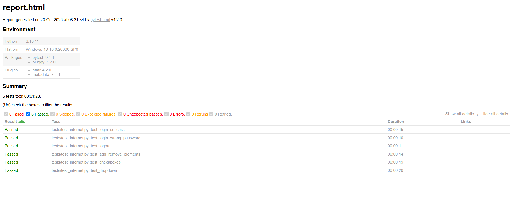

# Báo cáo kiểm thử tự động website với Selenium

## 1. Thông tin chung

- **Sinh viên** Nguyễn Đức Hiếu
- **Mã sinh viên:** 2301061
- **Website kiểm thử:** https://the-internet.herokuapp.com
- **Công cụ chính:** Selenium WebDriver (Python)
- **Số test case:** 6 (yêu cầu tối thiểu 5)
- **Kết quả:** 6 passed, 0 failed

## 2. Mục tiêu

- Tìm hiểu công cụ kiểm thử tự động Selenium qua video và tài liệu hướng dẫn.
- Xây dựng tối thiểu 5 test case kiểm thử tự động cho một website.
- Sinh báo cáo kết quả chạy test và nộp bài qua GitHub.

## 3. Giới thiệu Selenium

Selenium là bộ công cụ mã nguồn mở dùng để tự động hóa thao tác trên trình duyệt (mở trang, nhập liệu, bấm nút, đọc nội dung), phục vụ kiểm thử chức năng ứng dụng web. Selenium gồm 3 thành phần:

- **Selenium WebDriver:** thư viện cho phép viết code điều khiển trình duyệt. Bài này sử dụng thành phần này.
- **Selenium IDE:** tiện ích ghi và phát lại thao tác, không cần viết code.
- **Selenium Grid:** chạy test song song trên nhiều máy và nhiều trình duyệt.

Cách hoạt động: code Python gửi lệnh qua Selenium WebDriver, ChromeDriver chuyển lệnh cho Chrome thực hiện và trả kết quả về. Từ Selenium 4, ChromeDriver được tải tự động.

## 4. Website kiểm thử

[The Internet](https://the-internet.herokuapp.com) là website mẫu dùng để luyện kiểm thử tự động, gồm nhiều trang chức năng nhỏ như đăng nhập, thêm/xóa phần tử, checkbox, dropdown. Website không có captcha và giao diện ổn định nên phù hợp để thực hành.

- **Tài khoản đăng nhập:** `tomsmith`
- **Mật khẩu:** `SuperSecretPassword!`

## 5. Môi trường và công cụ

- Hệ điều hành: Windows 10
- Python 3.10.11
- Selenium 4.x
- pytest 9.1.1, pytest-html 4.2.0
- Trình duyệt: Google Chrome
- Editor: Visual Studio Code

## 6. Cấu trúc thư mục

```
Lab9-Selenium/
├── tests/
│   └── test_internet.py      # 6 test case tự động
├── screenshots/
│   ├── kết quả.png           # ảnh kết quả chạy trên terminal
│   └── report.png            # ảnh báo cáo HTML
├── report.html               # báo cáo HTML do pytest-html sinh ra
├── requirements.txt          # danh sách thư viện
├── .gitignore
└── README.md
```

## 7. Hướng dẫn cài đặt và chạy

```
git clone https://github.com/hieubin/Lab9-Selenium.git
cd Lab9-Selenium
python -m venv venv
venv\Scripts\activate
python -m pip install -r requirements.txt
python -m pytest -v --html=report.html --self-contained-html
```

Chrome tự mở và đóng cho từng test case. Kết quả hiển thị trên terminal và được lưu vào `report.html`.

## 8. Thiết kế mã kiểm thử

Toàn bộ code nằm trong `tests/test_internet.py`, gồm:

- **`driver` (pytest fixture):** mở Chrome trước mỗi test và đóng sau mỗi test, giúp các test độc lập với nhau.
- **`wait_for()`:** chờ phần tử hiển thị (tối đa 10 giây) bằng `WebDriverWait`.
- **`click()`:** chờ phần tử có thể bấm được rồi mới bấm.
- **`login()`:** hàm dùng chung cho các test cần đăng nhập.

Các kỹ thuật chính:

- Định vị phần tử bằng `By.ID`, `By.CLASS_NAME`, `By.CSS_SELECTOR`.
- Thao tác bằng `click()`, `send_keys()` và `Select(...).select_by_value()`.
- Chờ tường minh (`WebDriverWait` kết hợp `expected_conditions`) thay cho `time.sleep()`.
- Kiểm tra kết quả bằng `assert` (URL, nội dung thông báo, số lượng phần tử, trạng thái checkbox).

## 9. Danh sách test case

| ID | Tên test case | Các bước thực hiện | Kết quả mong đợi | Kết quả thực tế |
|----|---------------|--------------------|------------------|-----------------|
| TC01 | Đăng nhập thành công | 1. Mở trang /login<br>2. Nhập `tomsmith` / `SuperSecretPassword!`<br>3. Bấm Login | Chuyển sang /secure, hiện "You logged into a secure area!" | Pass |
| TC02 | Đăng nhập sai mật khẩu | 1. Mở trang /login<br>2. Nhập đúng username, sai mật khẩu<br>3. Bấm Login | Hiện "Your password is invalid!" | Pass |
| TC03 | Đăng xuất | 1. Đăng nhập thành công<br>2. Bấm Logout | Quay về /login, hiện "You logged out of the secure area!" | Pass |
| TC04 | Thêm và xóa phần tử | 1. Mở /add_remove_elements/<br>2. Bấm Add Element 3 lần<br>3. Bấm Delete 1 lần | Ban đầu có 3 phần tử, sau khi xóa còn 2 | Pass |
| TC05 | Checkbox | 1. Mở /checkboxes<br>2. Kiểm tra trạng thái ban đầu<br>3. Bấm checkbox 1 | Checkbox 1 ban đầu chưa chọn, checkbox 2 đã chọn; sau khi bấm checkbox 1 được chọn | Pass |
| TC06 | Dropdown | 1. Mở /dropdown<br>2. Chọn Option 2 | Dropdown hiển thị "Option 2" | Pass |

## 10. Kết quả chạy

Tổng kết: **6 test case, 6 passed, 0 failed.**

**Kết quả trên terminal:**


**Báo cáo HTML (`report.html`):**



## 11. Tài liệu tham khảo
- Selenium Python Beginner Tutorial (playlist Selenium Python, Class Central): https://www.classcentral.com/classroom/youtube-selenium-python-54381
- PyTest Tutorial - Selenium With Python - Learn PyTest in 90 Minutes (LambdaTest): https://www.classcentral.com/classroom/youtube-pytest-tutorial-selenium-with-python-learn-pytest-in-90-minutes-lambdatest-117675
- Selenium Python Tutorial: Getting Started With Pytest: https://himanshu-sheth.medium.com/selenium-python-tutorial-getting-started-with-pytest-b596cebae876
- Tài liệu chính thức Selenium: https://www.selenium.dev/documentation/
- Tài liệu pytest: https://docs.pytest.org/
- Website kiểm thử: https://the-internet.herokuapp.com
